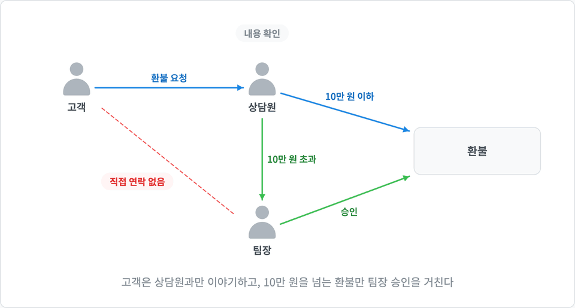
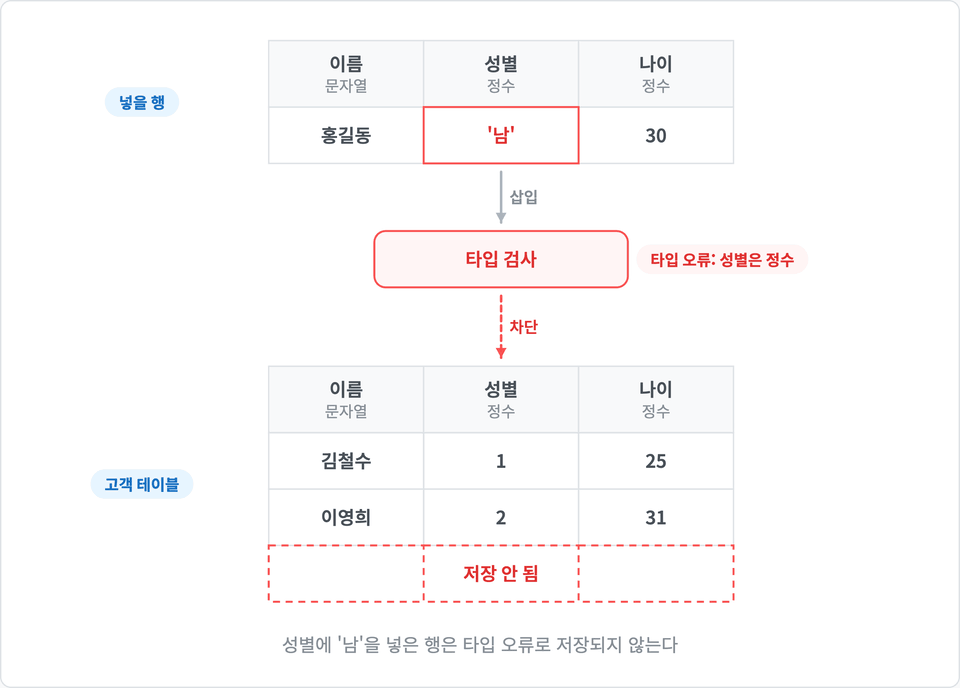
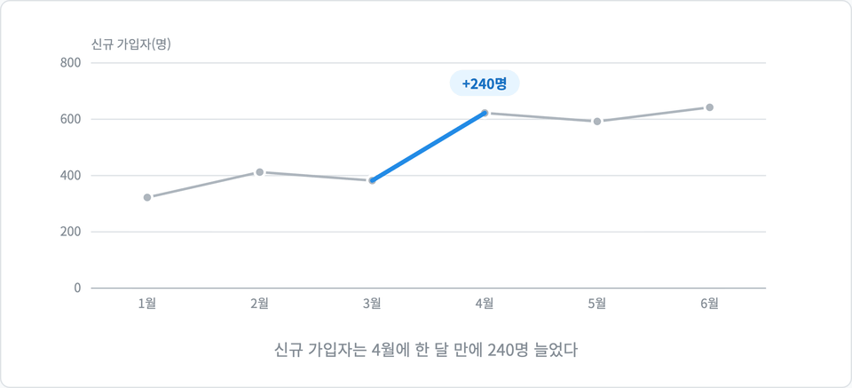
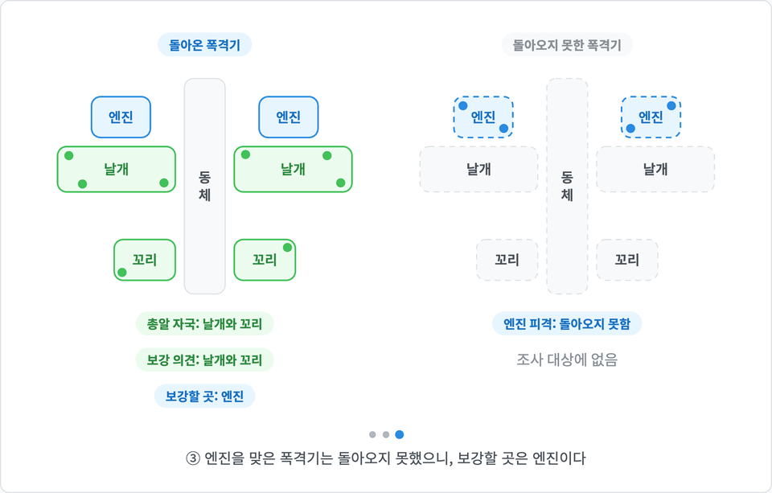

# dsviz

글, 문서, 데이터를 설명 그림으로 만드는 Claude Code 플러그인입니다. 개념도, 구조도, 흐름도, 표, 선/막대/산점도 차트를 단독 HTML(canvas)로 그리고, 그림이 그려지는 순서를 애니메이션으로 보여 줍니다. JS가 돌지 않는 곳(Confluence, 슬라이드, 메신저)에 넣을 애니메이션 WebP와 PNG도 내보냅니다.

<p align="center">
  <br>
  <sub>프롬프트: dsviz 스킬로 아래 글을 설명하는 다이어그램을 만들어줘.<br>"고객이 앱에서 환불을 요청하면 상담원이 먼저 내용을 확인한다. 금액이 10만 원 이하면 상담원이 바로 처리하고, 넘으면 팀장 승인을 받아야 환불된다. 고객은 상담원과만 이야기하고, 팀장과는 직접 연락하지 않는다."</sub>
</p>

## 설치

```
/plugin marketplace add namioto/dsviz
/plugin install dsviz@dsviz
```

## 사용

Claude Code에서 그림을 요청하면 스킬이 불립니다.

```
dsviz 스킬로 아래 글을 설명하는 다이어그램을 만들어줘.
"..."
```

- 진입점 3가지: 완성 그림 하나(`createDiagram`), 단계마다 캡션이 바뀌는 데모(`createDemo`), 독자가 값을 바꿔 보는 실험(`createLab`)
- 애니메이션 강도 3가지: 기본, 약하게(모든 요소가 처음부터 보이고 강조만 움직임), 끄기
- 사람은 사람 모양(`person`), 인원 비율은 사람 아이콘 격자(`people`)로 그림
- 색은 역할 이름(`focus` `alert` 등)으로만 지정해 라이트/다크 모드를 함께 지원
- 그린 뒤 자동 검사(글자 겹침, 넘침, 잘못된 순서 지정)와 캡처로 결과를 확인

## 예시

아래 프롬프트를 한 번 입력해 나온 그림입니다. 다시 고쳐 달라고 요청하지 않았습니다. 데모 16개 전체는 [demo](demo/README.md)에 있습니다.

### 비율을 사람 수로

```
dsviz 스킬로 아래 글을 설명하는 그림을 만들어줘.
"이번 달 새로 가입한 고객 100명 중 12명이 첫 주 안에 떠났다. '이탈률 12%'라는 숫자만 보면 작아 보이지만, 사람으로 세어 보면 열두 명이 일주일을 못 버티고 나간 것이다."
```

<p align="center"></p>

### 표

```
dsviz 스킬로 아래 내용을 그림으로 설명해줘.
"고객 테이블에 이름(문자열), 성별(정수), 나이(정수) 컬럼이 있다. 성별 컬럼에 '남' 같은 문자열을 넣으면 타입 오류가 나고, 그 행은 저장되지 않는다."
```

<p align="center"></p>

### 데이터만 주고 차트

```
dsviz 스킬로 아래 데이터를 차트로 그려줘.
월별 신규 가입자: 1월 320명, 2월 410명, 3월 380명, 4월 620명, 5월 590명, 6월 640명
```

<p align="center"></p>

### 단계별 데모

```
dsviz 스킬로 아래 글을 설명하는 그림을 만들어줘.
"전쟁 중 돌아온 폭격기들을 조사하니 총알 자국이 날개와 꼬리에 몰려 있었다. 그래서 날개와 꼬리를 보강하자는 의견이 나왔다. 하지만 엔진에 총알을 맞은 폭격기는 돌아오지 못했기 때문에 조사 대상에 없었다. 보강해야 할 곳은 엔진이었다."
```

<p align="center"></p>

## 필요한 것

- Node.js: 검증과 내보내기 스크립트가 처음 실행될 때 `npm i`로 Playwright를 설치합니다
- ffmpeg-full: WebP와 GIF 내보내기에 씁니다. 기본 `ffmpeg`에는 WebP 인코더가 없습니다

```
brew install ffmpeg-full   # macOS
winget install ffmpeg       # Windows
```

## 라이선스

MIT
