# dsviz 데모

아래 프롬프트를 한 번 입력해 나온 그림입니다. 다시 고쳐 달라고 요청하지 않았습니다. 그림을 누르면 원래 크기로 볼 수 있고, 원본 HTML은 [src](src)에 있습니다.

- [개념도](#개념도)
- [사람 수](#사람-수)
- [차트](#차트)
- [단계별 데모](#단계별-데모)
- [직접 조작하는 실험](#직접-조작하는-실험)

## 개념도

### 환불 처리

```
dsviz 스킬로 아래 글을 설명하는 다이어그램을 만들어줘.
"고객이 앱에서 환불을 요청하면 상담원이 먼저 내용을 확인한다. 금액이 10만 원 이하면 상담원이 바로 처리하고, 넘으면 팀장 승인을 받아야 환불된다. 고객은 상담원과만 이야기하고, 팀장과는 직접 연락하지 않는다."
```

<p align="center"></p>

원본: [src/refund.html](src/refund.html)

### 키오스크 주문

```
dsviz 스킬로 아래 글을 설명하는 다이어그램을 만들어줘.
"식당 키오스크에서 주문하면 주문 내용은 주방 화면으로 바로 전달되고, 손님은 진동벨을 받아 자리에서 기다린다. 조리가 끝나면 주방이 완료를 누르고, 그 신호가 진동벨을 울려 손님을 부른다. 손님과 주방은 직접 말을 나누지 않고 키오스크와 진동벨을 거쳐서만 소통한다."
```

<p align="center">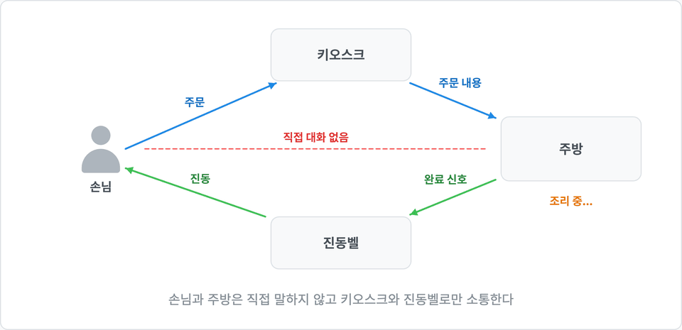</p>

원본: [src/kiosk.html](src/kiosk.html)

### 커피숍 병목

```
dsviz 스킬로 아래 글을 설명하는 다이어그램을 만들어줘.
"커피숍에서 주문이 밀리는 이유는 바리스타가 느려서가 아니라 계산대 한 곳에 손님이 몰리기 때문이다. 주문 접수 → 계산 → 제조 → 픽업 네 단계 중 가장 좁은 단계가 전체 속도를 정한다. 제조 머신을 늘려도 계산대가 하나면 줄은 줄지 않는다."
```

<p align="center">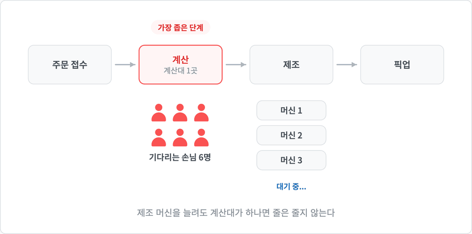</p>

원본: [src/coffee.html](src/coffee.html)

### 공급망 연쇄 지연

```
dsviz 스킬로 아래 글을 설명하는 다이어그램을 만들어줘.
"공급망에서 부품 공장 한 곳이 멈추면, 그 부품을 쓰는 조립 공장 두 곳이 멈추고, 다시 그 완제품을 받는 매장 네 곳의 진열대가 비게 된다. 한 지점의 지연이 아래로 내려갈수록 넓게 퍼진다."
```

<p align="center">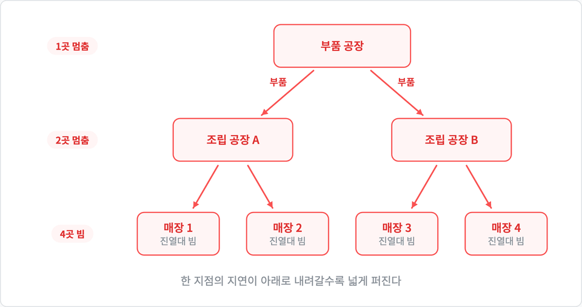</p>

원본: [src/supply.html](src/supply.html)

### 퇴고 반복

```
dsviz 스킬로 아래 글을 설명하는 다이어그램을 만들어줘.
"좋은 글은 한 번에 나오지 않는다. 초안을 쓴 뒤 소리 내어 읽고, 걸리는 문장을 고치고, 다시 읽는다. 읽다가 걸리는 문장이 하나도 없을 때 비로소 퇴고가 끝난다."
```

<p align="center">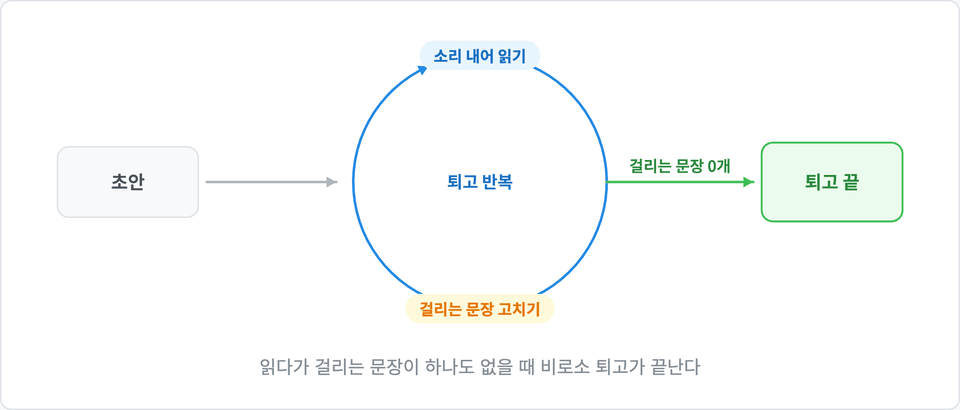</p>

원본: [src/revise.html](src/revise.html)

### 교통수단 선택

```
dsviz 스킬로 아래 글을 설명하는 다이어그램을 만들어줘.
"약속 장소까지 갈 방법은 걷기, 버스, 택시 세 가지다. 무조건 빠른 택시를 타는 게 정답은 아니다. 남은 시간이 넉넉하면 걷고, 조금 빠듯하면 버스를 타고, 늦을 것 같을 때만 택시를 탄다. 상황에 맞는 하나를 고르는 것이 핵심이다."
```

<p align="center">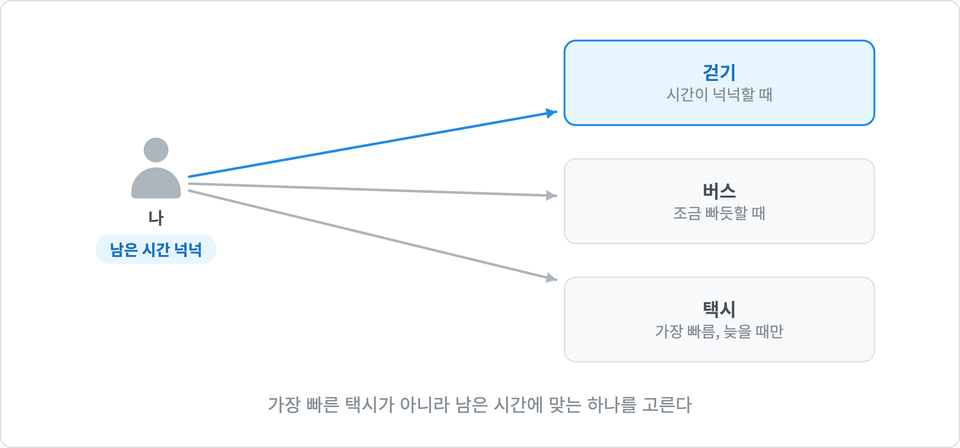</p>

원본: [src/transport.html](src/transport.html)

### 컬럼 타입 오류

```
dsviz 스킬로 아래 내용을 그림으로 설명해줘.
"고객 테이블에 이름(문자열), 성별(정수), 나이(정수) 컬럼이 있다. 성별 컬럼에 '남' 같은 문자열을 넣으면 타입 오류가 나고, 그 행은 저장되지 않는다."
```

<p align="center"></p>

원본: [src/table.html](src/table.html)

## 사람 수

### 신규 고객 이탈

```
dsviz 스킬로 아래 글을 설명하는 그림을 만들어줘.
"이번 달 새로 가입한 고객 100명 중 12명이 첫 주 안에 떠났다. '이탈률 12%'라는 숫자만 보면 작아 보이지만, 사람으로 세어 보면 열두 명이 일주일을 못 버티고 나간 것이다."
```

<p align="center"></p>

원본: [src/churn.html](src/churn.html)

## 차트

### 월별 신규 가입자

```
dsviz 스킬로 아래 데이터를 차트로 그려줘.
월별 신규 가입자: 1월 320명, 2월 410명, 3월 380명, 4월 620명, 5월 590명, 6월 640명
```

<p align="center"></p>

원본: [src/signups.html](src/signups.html)

### 분기별 채널 매출

```
dsviz 스킬로 아래 데이터를 차트로 그려줘.
분기별 채널 매출(억원): 1분기 온라인 12, 매장 30 / 2분기 온라인 18, 매장 28 / 3분기 온라인 25, 매장 27 / 4분기 온라인 34, 매장 25
```

<p align="center">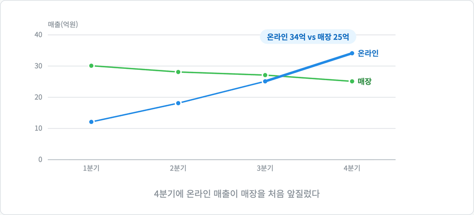</p>

원본: [src/channel.html](src/channel.html)

### 외식비와 노트북

```
dsviz 스킬로 아래 글을 설명하는 차트를 만들어줘.
"가계부를 보면 외식비는 매달 조금씩 늘어 1년 사이 두 배가 됐지만 한 번도 눈에 띄지 않았다. 반면 4월에 노트북을 산 달의 지출은 바로 눈에 띄었다. 조금씩 쌓이는 변화가 한 번에 뛰는 변화보다 알아채기 어렵다."
```

<p align="center">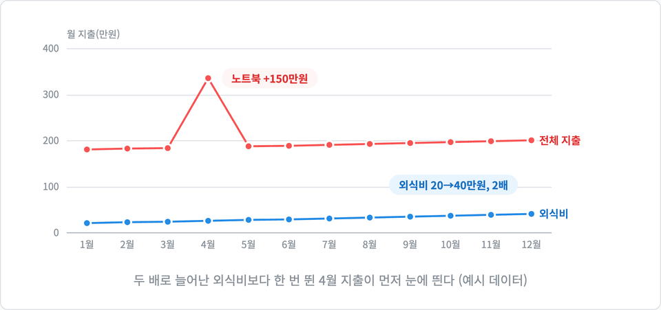</p>

원본: [src/spending.html](src/spending.html)

## 단계별 데모

### 돌아온 폭격기

```
dsviz 스킬로 아래 글을 설명하는 그림을 만들어줘.
"전쟁 중 돌아온 폭격기들을 조사하니 총알 자국이 날개와 꼬리에 몰려 있었다. 그래서 날개와 꼬리를 보강하자는 의견이 나왔다. 하지만 엔진에 총알을 맞은 폭격기는 돌아오지 못했기 때문에 조사 대상에 없었다. 보강해야 할 곳은 엔진이었다."
```

<p align="center"></p>

원본: [src/bomber.html](src/bomber.html)

### 화분 신호

```
dsviz 스킬로 아래 글을 설명하는 다이어그램을 만들어줘.
"화분이 갑자기 죽은 것처럼 보여도 신호는 미리 와 있었다. 먼저 흙이 바싹 말라 단단해지고, 며칠 뒤 잎 끝이 갈색으로 변하고, 새 잎이 더 나오지 않는다. 잎이 떨어진 건 맨 마지막이었다. 앞선 신호를 알아챘다면 살릴 수 있었다."
```

<p align="center">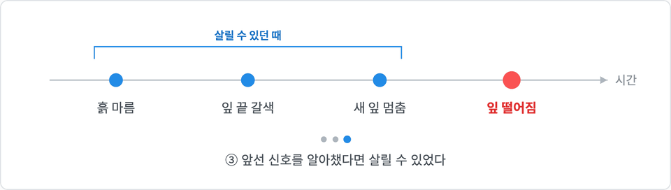</p>

원본: [src/plant.html](src/plant.html)

### 두 반의 시험 점수

```
dsviz 스킬로 아래 글을 설명하는 차트를 만들어줘.
"두 반의 수학 시험 평균은 똑같이 70점이다. 그런데 A반은 대부분 65~75점에 몰려 있고, B반은 40점대와 90점대로 갈려 있다. 평균만 보면 두 반의 차이를 놓친다."
```

<p align="center">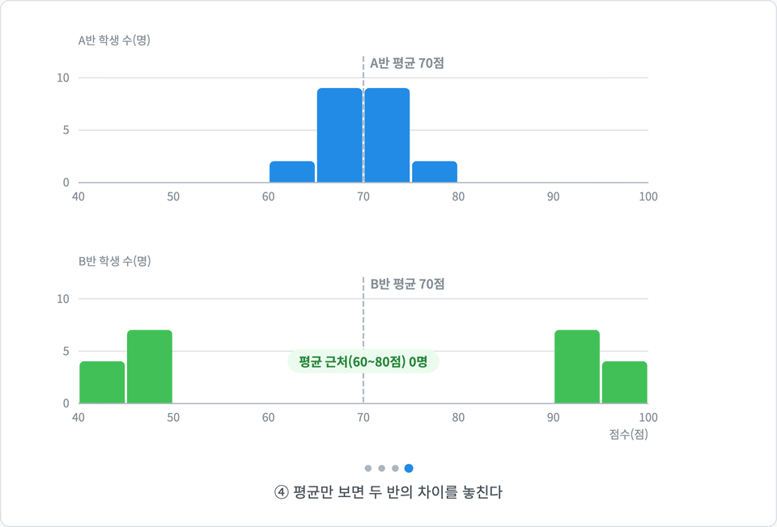</p>

원본: [src/scores.html](src/scores.html)

### 할인율과 이익

```
dsviz 스킬로 아래 글을 설명하는 그림을 만들어줘.
"할인율을 높이면 주문 수는 계속 늘어난다. 그래서 할인을 크게 할수록 좋아 보인다. 하지만 이익은 할인율 20% 근처에서 가장 크고, 그 뒤로는 주문이 늘어도 오히려 줄어든다. 주문 수만 보면 이 꺾이는 지점을 놓친다."
```

<p align="center">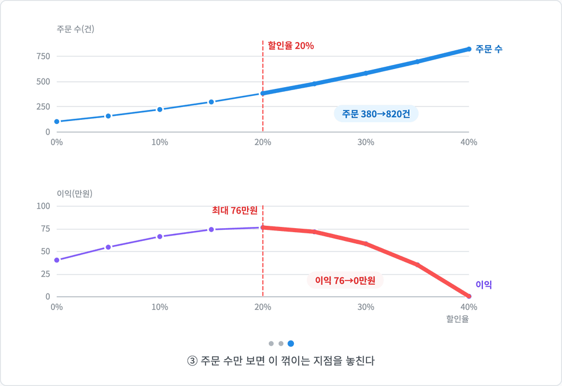</p>

원본: [src/discount.html](src/discount.html)

## 직접 조작하는 실험

### 계산대 실험

```
dsviz 스킬로 아래 내용을 직접 조작해 볼 수 있게 만들어줘.
"계산대가 한 곳이면 손님이 조금만 더 와도 줄이 끝없이 길어진다. 계산대를 두 곳으로 늘리면 같은 손님 수에서도 줄이 금방 줄어든다."
```

<p align="center">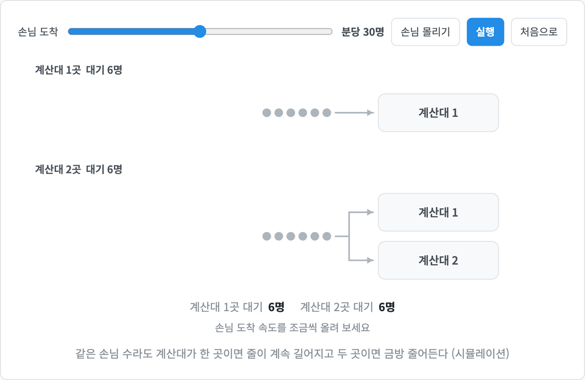</p>

원본: [src/counter.html](src/counter.html). 실험은 HTML을 브라우저로 열어야 직접 조작할 수 있습니다. 그림은 기본 설정으로 돌린 장면입니다

